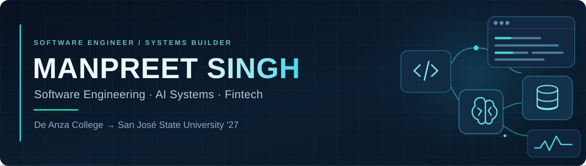
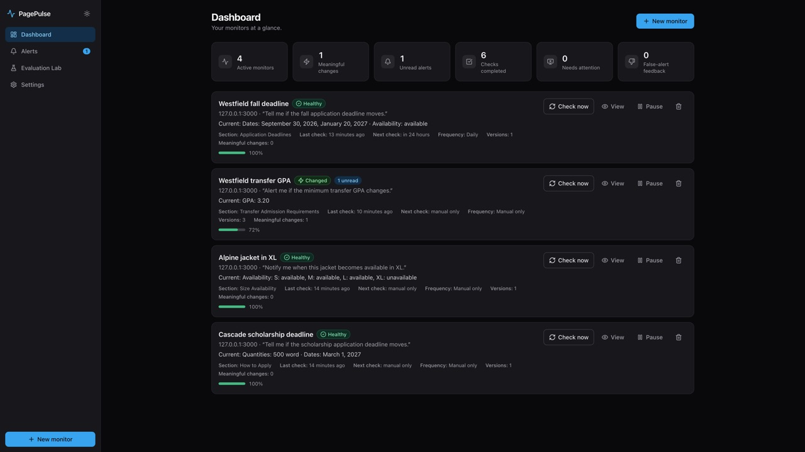
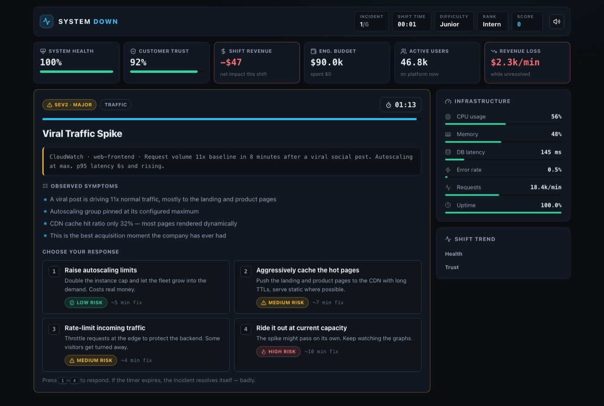
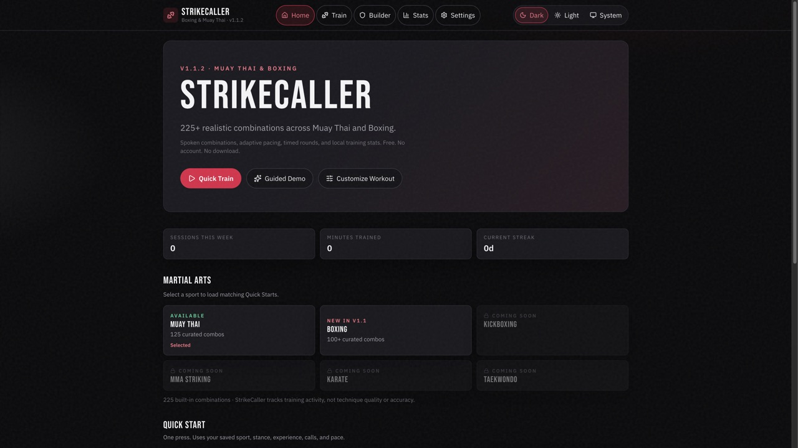

  

 

**Computer Science + Finance** | Building practical software, automation, and decision-support tools

Computer Science student at **De Anza College**, preparing to pursue Finance alongside Computer Science. I build products that combine technology, business thinking, and real-world problem solving — with interests spanning fintech, software engineering, automation, data-driven products, decision-support systems, solutions engineering, and technical consulting.

Open to **internship opportunities** where I can contribute to practical software and learn how technology supports better decisions.

  <a href="https://www.linkedin.com/in/manpreet-singh-1018b3299/">LinkedIn</a>
  ·
  <a href="mailto:manpreetsm2@gmail.com">Email</a>
  ·
  <a href="https://github.com/ManpreetS2">GitHub</a>

  
  &nbsp;
  
  &nbsp;
  

---

## About Me

I enjoy building technology that helps people understand complicated information, make better decisions, automate repetitive work, and interact with data more clearly. My projects tend to sit at the intersection of computer science, finance, business strategy, and product development — tools that solve a concrete problem without unnecessary complexity.

---

## Featured Projects

### PagePulse

**Status:** Active · Portfolio Project

Evidence-first webpage monitoring platform that filters cosmetic page noise and alerts only when the information you care about actually changes, with old and new evidence on every alert.

**Tech:** TypeScript · React · Node.js · Express · SQLite · Vite · Tailwind CSS

- [Repository](https://github.com/ManpreetS2/pagepulse)

---

### System Down Simulator

**Status:** Live Demo

Interactive incident-response strategy game where players manage software outages while balancing system health, revenue, customer trust, engineering budget, and response time.

**Tech:** TypeScript · React · Vite · GitHub Actions

- [Repository](https://github.com/ManpreetS2/system-down-simulator)
- [Live Demo](https://manpreets2.github.io/system-down-simulator/)

---

### StrikeCaller

**Status:** Live Demo · Active

Browser-based Muay Thai and Boxing training coach that speaks realistic combinations with adaptive pacing, timed rounds, and local training stats. StrikeCaller tracks training activity; it does not evaluate technique quality, accuracy, power, or motion.

**Tech:** TypeScript · React · Vite · Vitest · Testing Library

- [Repository](https://github.com/ManpreetS2/strikecaller)
- [Live Demo](https://manpreets2.github.io/strikecaller/)

---

### BudgetingWebsite

**Status:** Portfolio Project

Browser-based personal-finance tools for budgeting and payment planning, including a car-payment calculator.

**Tech:** HTML · CSS · JavaScript

- [Repository](https://github.com/ManpreetS2/BudgetingWebsite)

---

## Computer Science × Finance

Areas I am interested in exploring:

- Fintech products
- Financial data visualization
- Budgeting and personal-finance tools
- Risk and decision-support systems
- Business process automation
- Evidence-backed software
- Technology consulting
- Solutions engineering

These are directions I want to grow into — not claims of finished expertise.

---

## Technology Stack

**Languages**

**Frontend**

**Backend and Data**

**Testing and Quality**

**Tools**

---

## Current Focus

- Strengthening computer science fundamentals
- Preparing to pursue Finance alongside Computer Science
- Building portfolio projects with real-world use cases
- Learning more about fintech, data, automation, and product engineering
- Seeking internship opportunities

---

## Engineering Approach

- Build around a clear user problem
- Make uncertainty and evidence visible
- Test important workflows
- Keep interfaces understandable
- Prefer practical features over fake complexity
- Document limitations honestly

---

## GitHub Activity

  
  

---

## Contact

Happy to talk about internships, software projects, fintech, automation, and technology-business problems.

- **LinkedIn:** [linkedin.com/in/manpreet-singh-1018b3299](https://www.linkedin.com/in/manpreet-singh-1018b3299/)
- **Email:** [manpreetsm2@gmail.com](mailto:manpreetsm2@gmail.com)
- **GitHub:** [github.com/ManpreetS2](https://github.com/ManpreetS2)
