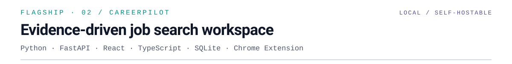

<!--
  Editorial profile README — animated SVG portfolio.
  Light/dark via <picture> (reliable on GitHub). Animations live inside SVGs.
-->

  <picture>
    <source media="(prefers-color-scheme: dark)" srcset="assets/editorial/dark/hero.svg"/>
    
  </picture>

  

    <a href="https://www.linkedin.com/in/manpreet-singh-1018b3299/">LinkedIn</a>
    ·
    <a href="mailto:manpreetsm2@gmail.com">Email</a>
    ·
    <a href="https://github.com/ManpreetS2?tab=repositories">All repositories</a>
  

<picture>
  <source media="(prefers-color-scheme: dark)" srcset="assets/editorial/dark/s01.svg"/>
  
</picture>

<picture>
  <source media="(prefers-color-scheme: dark)" srcset="assets/editorial/dark/whoami.svg"/>
  
</picture>

<picture>
  <source media="(prefers-color-scheme: dark)" srcset="assets/editorial/dark/s02.svg"/>
  
</picture>

<picture>
  <source media="(prefers-color-scheme: dark)" srcset="assets/editorial/dark/featured-meta.svg"/>
  
</picture>

<picture>
  <source media="(prefers-color-scheme: dark)" srcset="assets/editorial/dark/featured-points.svg"/>
  
</picture>

  <a href="https://github.com/ManpreetS2/CareerPilot"><strong>Explore CareerPilot →</strong></a>
  ·
  <a href="https://github.com/ManpreetS2/CareerPilot/tree/main/docs/showcase">Architecture &amp; showcase</a>
  ·
  <a href="https://github.com/ManpreetS2/CareerPilot/actions/workflows/ci.yml">CI</a>

Local/self-hostable · no public hosted demo · Chrome extension assists fills but never submits applications

<picture>
  <source media="(prefers-color-scheme: dark)" srcset="assets/editorial/dark/s03.svg"/>
  
</picture>

<table>
<tr>
<td width="50%" valign="top">
  <a href="https://github.com/ManpreetS2/IntegrationLab">
    <picture>
      <source media="(prefers-color-scheme: dark)" srcset="https://raw.githubusercontent.com/ManpreetS2/IntegrationLab/main/docs/assets/final/overview-dark.png"/>
      
    </picture>
  </a>
  <h3><a href="https://github.com/ManpreetS2/IntegrationLab">IntegrationLab</a></h3>
  
Self-hosted console for diagnosing API and webhook failures with stored evidence, signed webhook processing, and retry handling.

  FastAPI · PostgreSQL · React · Docker
</td>
<td width="50%" valign="top">
  
  <h3><a href="https://github.com/ManpreetS2/R.E.A.C.T">R.E.A.C.T.</a></h3>
  
Research prototype testing whether numerical reward feedback changes language-model controller revisions in a physics simulator.

  Python · LunarLander · Experimentation · Research prototype
</td>
</tr>
<tr>
<td width="50%" valign="top">
  
  <h3><a href="https://github.com/ManpreetS2/EquityTrace">EquityTrace</a></h3>
  
Point-in-time stock research from SEC filings, auditable financial factors, and transparent historical portfolio backtesting.

  Python · SEC XBRL · DuckDB
</td>
<td width="50%" valign="top">
  
  <h3><a href="https://github.com/ManpreetS2/Minecraft-Ai-Civilization">Minecraft AI Civilization</a></h3>
  
Multi-agent simulation with persistent memory, planning, and actions inside a shared Minecraft world — in active development.

  TypeScript · Mineflayer · SQLite · In development
</td>
</tr>
</table>

### More things I've built

- **[StrikeCaller](https://github.com/ManpreetS2/StrikeCaller)** — Spoken boxing and Muay Thai training app. [Live demo ↗](https://manpreets2.github.io/StrikeCaller/)
- **[PagePulse](https://github.com/ManpreetS2/PagePulse)** — Webpage monitoring that distinguishes meaningful factual changes from page noise.
- **[Java Banking System](https://github.com/ManpreetS2/JavaBankingSystem)** — JavaFX desktop banking simulation with atomic transfers and a downloadable macOS release.
- **[System Down Simulator](https://github.com/ManpreetS2/System-Down-Simulator)** — Browser game about managing software outages. [Play ↗](https://manpreets2.github.io/System-Down-Simulator/)

<picture>
  <source media="(prefers-color-scheme: dark)" srcset="assets/editorial/dark/s04.svg"/>
  
</picture>

<picture>
  <source media="(prefers-color-scheme: dark)" srcset="assets/editorial/dark/toolkit.svg"/>
  
</picture>

<picture>
  <source media="(prefers-color-scheme: dark)" srcset="assets/editorial/dark/footer.svg"/>
  
</picture>

  

    <a href="https://www.linkedin.com/in/manpreet-singh-1018b3299/">LinkedIn</a>
    ·
    <a href="mailto:manpreetsm2@gmail.com">Get in touch</a>
  

