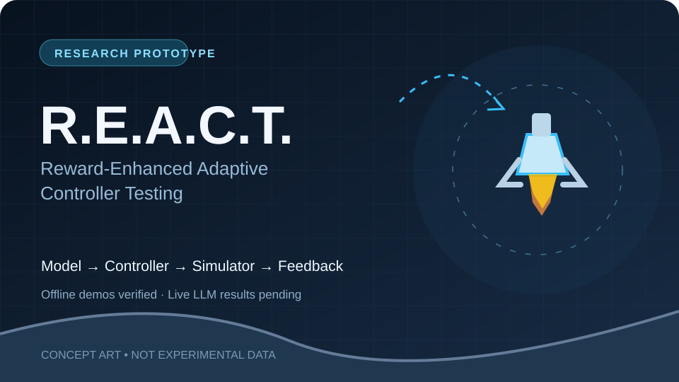
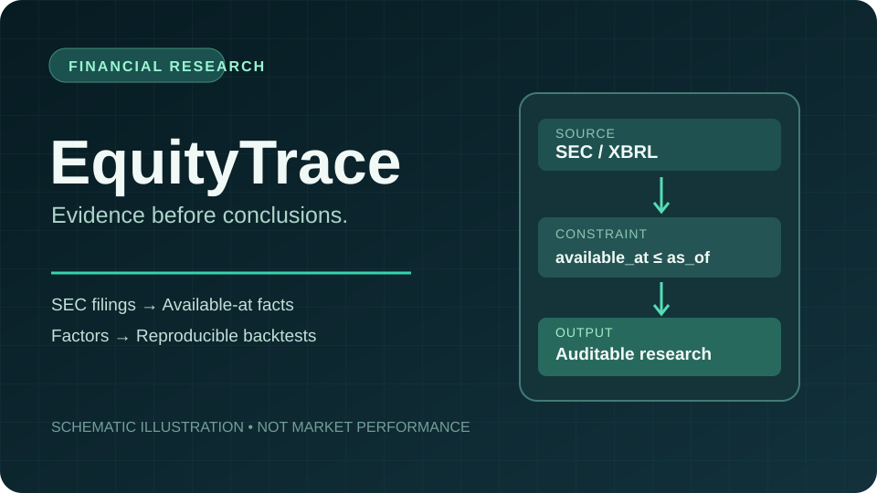
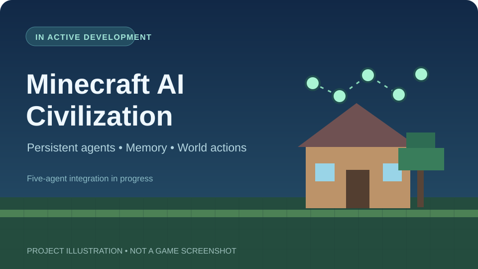

  

  
<strong>Computer Science @ De Anza College → Incoming San José State University (Spring 2027)</strong>

  
I build evidence-driven software: systems that explain what happened, where the data came from, and whether a result can be trusted.

  
  
  

---

## About me

I'm a Computer Science student interested in **software engineering, reliable AI systems, quantitative research, and developer tools**. I enjoy projects where correctness is not just an aspiration: a result needs tests, provenance, guardrails, or reproducible experiments to support it.

I'm moving from **De Anza College to San José State University for Spring 2027** and exploring **software engineering, solutions engineering, and technical internship opportunities**.

What I tend to build:
- **Reliable backends:** explicit failure states, bounded retries, ownership boundaries, and auditability.
- **AI-assisted products:** grounded outputs, verifiable decisions, and human control over consequential actions.
- **Research tools:** deterministic evaluations, reproducible runs, and honest treatment of missing evidence.

## Featured engineering

### 01 / IntegrationLab — investigate integration failures with evidence

**Python · FastAPI · PostgreSQL · React · TypeScript · Docker · GitHub OAuth · Stripe test-mode webhooks**

A local, self-hosted investigation console for OAuth/API and webhook failures. It separates actual provider observations, SDK-reported telemetry, and deliberately simulated faults so operators don't mistake one for another.

**The engineering:** signature-verified webhook receipt, deduplicated deliveries, bounded retries, recovery of stalled work, credential isolation, support cases, and audit records. Automated checks exercise the backend, frontend, containers, and assembled local stack.

**Scope:** local portfolio software, **not** a hosted production monitoring service. SDK telemetry is reported by the client application; it is not independent provider verification.

[**Repository & architecture →**](https://github.com/ManpreetS2/IntegrationLab) · [CI](https://github.com/ManpreetS2/IntegrationLab/actions/workflows/ci.yml) · [Webhook implementation](https://github.com/ManpreetS2/IntegrationLab/blob/main/backend/app/services/webhook_processor.py)

### 02–07 / More selected work

<table>
  <tr>
    <td width="50%" valign="top">
      
      <h3><a href="https://github.com/ManpreetS2/CareerPilot">CareerPilot</a></h3>
      
<strong>AI-assisted job search · Full-stack application</strong>

      
Resume-grounded candidate profiles, deterministic and explainable Fit scores, job discovery, application preparation, and human-reviewed Greenhouse/Lever form assistance. The extension never submits applications.

      
Python · FastAPI · React · TypeScript · SQLite · Chrome extension

      
<a href="https://github.com/ManpreetS2/CareerPilot">Explore project →</a>

    </td>
    <td width="50%" valign="top">
      
      <h3><a href="https://github.com/ManpreetS2/R.E.A.C.T">R.E.A.C.T.</a></h3>
      
<strong>Reward-Enhanced Adaptive Controller Testing · Research prototype</strong>

      
Tests whether numerical reward feedback changes how language models revise constrained simulator controllers. Includes offline demonstrations, seed isolation, sealed held-out evaluation, spending gates, and replayable logs. <strong>No validated real-model ranking has been published.</strong>

      
Python · Gymnasium · ApolloLander · SQLite · Model provider adapters

      
<a href="https://github.com/ManpreetS2/R.E.A.C.T">Explore experiment design →</a>

    </td>
  </tr>
  <tr>
    <td width="50%" valign="top">
      
      <h3><a href="https://github.com/ManpreetS2/EquityTrace">EquityTrace</a></h3>
      
<strong>Quantitative finance · Point-in-time research</strong>

      
Transforms SEC filings into auditable financial facts and factors, then supports reproducible historical portfolio research. Availability timestamps and leakage tests help prevent future information from contaminating past decisions.

      
Python · SEC XBRL · DuckDB · Financial factors · Backtesting

      
<a href="https://github.com/ManpreetS2/EquityTrace">Explore research engine →</a>

    </td>
    <td width="50%" valign="top">
      
      <h3><a href="https://github.com/ManpreetS2/Minecraft-Ai-Civilization">Minecraft AI Civilization</a></h3>
      
<strong>Persistent agents · Simulation · In development</strong>

      
An experimental shared Minecraft world where agents have persistent state, memories, and bounded game-world skills. Individual physical skills have been tested; the complete autonomous five-agent simulation is still being integrated.

      
TypeScript · Mineflayer · SQLite · Agent orchestration

      
<a href="https://github.com/ManpreetS2/Minecraft-Ai-Civilization">Explore architecture →</a>

    </td>
  </tr>
  <tr>
    <td width="50%" valign="top">
      
      <h3><a href="https://github.com/ManpreetS2/StrikeCaller">StrikeCaller</a></h3>
      
<strong>Shipped browser application · Boxing & Muay Thai</strong>

      
A spoken combo and round-training coach with stance-aware sequences, adaptive timing, offline use, and local workout history. Tracks training activity, not technique quality.

      
React · TypeScript · Vitest · Playwright · Web Speech API

      
<a href="https://manpreets2.github.io/StrikeCaller/">Try live demo ↗</a> · <a href="https://github.com/ManpreetS2/StrikeCaller">Source →</a>

    </td>
    <td width="50%" valign="top">
      
      <h3><a href="https://github.com/ManpreetS2/PagePulse">PagePulse</a></h3>
      
<strong>Evidence-based webpage change monitoring</strong>

      
Watches public webpages for meaningful factual changes rather than cosmetic edits. Uses structured fact extraction, intent filters, old/new evidence, version history, and a guided evaluation demo.

      
TypeScript · React · Node.js · Express · SQLite

      
<a href="https://github.com/ManpreetS2/PagePulse">Explore monitoring pipeline →</a>

    </td>
  </tr>
</table>

## Also built

<table>
  <tr>
    <td width="50%" valign="top">
      
      <h3><a href="https://github.com/ManpreetS2/JavaBankingSystem">Java Banking System</a></h3>
      
Local JavaFX desktop banking simulation with atomic internal transfers, exact decimal money handling, account ownership checks, SQLite persistence, automated tests, and a packaged <a href="https://github.com/ManpreetS2/JavaBankingSystem/releases/tag/v1.0.0">v1.0.0 macOS release</a> (unsigned).

    </td>
    <td width="50%" valign="top">
      
      <h3><a href="https://github.com/ManpreetS2/System-Down-Simulator">System Down Simulator</a></h3>
      
A fun incident-response strategy game about outages, trade-offs, on-call decisions, and postmortems. One of my earlier experimental builds, and still playable.

      
<a href="https://manpreets2.github.io/System-Down-Simulator/">Play live demo ↗</a>

    </td>
  </tr>
</table>

## Technologies I work with

| Area | Tools |
| --- | --- |
| **Languages** | Python, TypeScript, Java, JavaScript, SQL |
| **Backend & data** | FastAPI, Node.js, PostgreSQL, SQLite, DuckDB, REST APIs |
| **Frontend & desktop** | React, Vite, HTML/CSS, JavaFX |
| **Engineering** | Git, GitHub Actions, Docker, pytest, Vitest, Playwright, JUnit |
| **AI & experimentation** | LLM provider APIs, structured model outputs, experiment logging, simulation adapters |

## How I approach projects

- **Make evidence visible.** A confident-looking answer is not the same as a verified result.
- **Design around failure.** Retries, isolation, permissions, and honest unknown states matter.
- **Prefer reproducibility over impressive claims.** Tests, source links, realistic demos, and disclosed limitations do the talking.
- **Keep learning in public.** Not everything here is production software; prototypes and experiments are labeled as such.

My earliest work includes <a href="https://github.com/ManpreetS2/BudgetingWebsite">BudgetingWebsite</a>, a reminder of where I started. The projects above show where I'm headed.

---

  <strong>Interested in software engineering, AI systems, fintech, and solutions engineering.</strong>
  
<a href="https://www.linkedin.com/in/manpreet-singh-1018b3299/">LinkedIn</a> · <a href="mailto:manpreetsm2@gmail.com">Email</a> · <a href="https://github.com/ManpreetS2?tab=repositories">All repositories</a>

  Project images are actual application screenshots unless explicitly labeled illustrations. Research prototypes are not represented as validated model results or production deployments.

