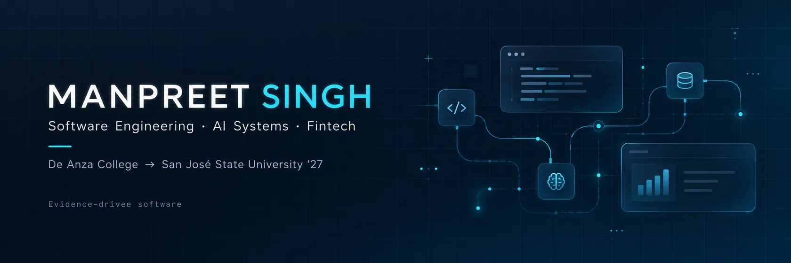

  

  **Computer Science @ De Anza College · Incoming San José State University, Spring 2027**

  I build practical software, AI-powered tools, and systems designed around reliability and real-world problems.

  [LinkedIn](https://www.linkedin.com/in/manpreet-singh-1018b3299/) · [Email](mailto:manpreetsm2@gmail.com) · [All repositories](https://github.com/ManpreetS2?tab=repositories)

---

## Featured project · CareerPilot

### [CareerPilot — An evidence-driven job search workspace](https://github.com/ManpreetS2/CareerPilot)

**Python · FastAPI · React · TypeScript · SQLite · Chrome Extension**

CareerPilot turns a resume into a grounded candidate profile, finds relevant jobs, and explains **why** a position matches your experience. It also helps prepare application materials, track applications, and practice interviews.

- **Explainable matching:** deterministic Fit scores backed by evidence rather than invented qualifications.
- **Full application workflow:** discovery, analysis, preparation, tracking, and candidate-scoped accounts.
- **Human-controlled assistance:** a Chrome extension helps fill supported Greenhouse and Lever forms but **never submits applications**.

**Status:** Local/self-hostable application; no public hosted demo.

[**Explore CareerPilot →**](https://github.com/ManpreetS2/CareerPilot) · [Architecture & showcase](https://github.com/ManpreetS2/CareerPilot/tree/main/docs/showcase) · [CI](https://github.com/ManpreetS2/CareerPilot/actions/workflows/ci.yml)

---

## Selected projects

<table>
<tr>
<td width="50%" valign="top">
  
  <h3><a href="https://github.com/ManpreetS2/IntegrationLab">IntegrationLab</a></h3>
  
A self-hosted console for diagnosing API and webhook failures with recorded evidence, signed webhook processing, and retry handling.

  FastAPI · PostgreSQL · React · Docker
</td>
<td width="50%" valign="top">
  
  <h3><a href="https://github.com/ManpreetS2/R.E.A.C.T">R.E.A.C.T.</a></h3>
  
Testing how numerical reward feedback influences language-model controller revisions in physics simulators.

  Python · LunarLander · Experimentation · Research prototype
</td>
</tr>
<tr>
<td width="50%" valign="top">
  
  <h3><a href="https://github.com/ManpreetS2/EquityTrace">EquityTrace</a></h3>
  
Point-in-time stock research built on SEC filings, auditable financial factors, and historical portfolio backtesting.

  Python · SEC XBRL · DuckDB
</td>
<td width="50%" valign="top">
  
  <h3><a href="https://github.com/ManpreetS2/Minecraft-Ai-Civilization">Minecraft AI Civilization</a></h3>
  
A developing multi-agent simulation with persistent memory, planning, and actions inside a shared Minecraft world.

  TypeScript · Mineflayer · SQLite · In development
</td>
</tr>
</table>

### More things I've built

- **[StrikeCaller](https://github.com/ManpreetS2/StrikeCaller)** — A spoken boxing and Muay Thai training app. [Live demo ↗](https://manpreets2.github.io/StrikeCaller/)
- **[PagePulse](https://github.com/ManpreetS2/PagePulse)** — Webpage monitoring that distinguishes meaningful factual changes from page noise.
- **[Java Banking System](https://github.com/ManpreetS2/JavaBankingSystem)** — A JavaFX desktop banking simulation with atomic transfers and a downloadable macOS release.
- **[System Down Simulator](https://github.com/ManpreetS2/System-Down-Simulator)** — A browser game about managing software outages. [Play ↗](https://manpreets2.github.io/System-Down-Simulator/)

## Stack

**Languages:** Python · TypeScript · Java · JavaScript · SQL  
**Frameworks & data:** FastAPI · React · Node.js · PostgreSQL · SQLite · DuckDB · JavaFX  
**Tools:** Git · Docker · GitHub Actions · pytest · Vitest · Playwright · JUnit

---

  Open to software engineering, solutions engineering, and technical internship opportunities.
  
<a href="https://www.linkedin.com/in/manpreet-singh-1018b3299/">LinkedIn</a> · <a href="mailto:manpreetsm2@gmail.com">Get in touch</a>

