<!--
  Editorial profile README — SVG-driven portfolio (Sharann-inspired structure, original art).
  Light/dark + mobile via <picture>. Animations fail-safe: resting SVG state is always visible.
  No JavaScript. Project links are real Markdown/HTML anchors (SVG-as-img is not clickable inside).
-->

<picture>
  <source media="(max-width: 500px) and (prefers-color-scheme: dark)" srcset="assets/editorial/mobile/dark/hero.svg"/>
  <source media="(max-width: 500px)" srcset="assets/editorial/mobile/light/hero.svg"/>
  <source media="(prefers-color-scheme: dark)" srcset="assets/editorial/dark/hero.svg"/>
  
</picture>

  <a href="https://www.linkedin.com/in/manpreet-singh-1018b3299/">LinkedIn</a>
  ·
  <a href="mailto:manpreetsm2@gmail.com">Email</a>
  ·
  <a href="https://github.com/ManpreetS2?tab=repositories">Repositories</a>

<picture>
  <source media="(max-width: 500px) and (prefers-color-scheme: dark)" srcset="assets/editorial/mobile/dark/s01.svg"/>
  <source media="(max-width: 500px)" srcset="assets/editorial/mobile/light/s01.svg"/>
  <source media="(prefers-color-scheme: dark)" srcset="assets/editorial/dark/s01.svg"/>
  
</picture>

<picture>
  <source media="(max-width: 500px) and (prefers-color-scheme: dark)" srcset="assets/editorial/mobile/dark/whoami.svg"/>
  <source media="(max-width: 500px)" srcset="assets/editorial/mobile/light/whoami.svg"/>
  <source media="(prefers-color-scheme: dark)" srcset="assets/editorial/dark/whoami.svg"/>
  
</picture>

<picture>
  <source media="(max-width: 500px) and (prefers-color-scheme: dark)" srcset="assets/editorial/mobile/dark/s02.svg"/>
  <source media="(max-width: 500px)" srcset="assets/editorial/mobile/light/s02.svg"/>
  <source media="(prefers-color-scheme: dark)" srcset="assets/editorial/dark/s02.svg"/>
  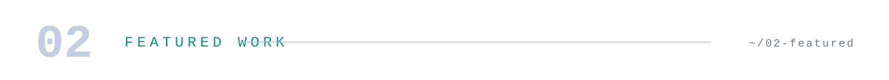
</picture>

<picture>
  <source media="(max-width: 500px) and (prefers-color-scheme: dark)" srcset="assets/editorial/mobile/dark/system-map.svg"/>
  <source media="(max-width: 500px)" srcset="assets/editorial/mobile/light/system-map.svg"/>
  <source media="(prefers-color-scheme: dark)" srcset="assets/editorial/dark/system-map.svg"/>
  
</picture>

<picture>
  <source media="(max-width: 500px) and (prefers-color-scheme: dark)" srcset="assets/editorial/mobile/dark/s03.svg"/>
  <source media="(max-width: 500px)" srcset="assets/editorial/mobile/light/s03.svg"/>
  <source media="(prefers-color-scheme: dark)" srcset="assets/editorial/dark/s03.svg"/>
  
</picture>

<a href="https://github.com/ManpreetS2/CareerPilot">
  <picture>
    <source media="(max-width: 500px) and (prefers-color-scheme: dark)" srcset="assets/editorial/mobile/dark/flagship-meta.svg"/>
    <source media="(max-width: 500px)" srcset="assets/editorial/mobile/light/flagship-meta.svg"/>
    <source media="(prefers-color-scheme: dark)" srcset="assets/editorial/dark/flagship-meta.svg"/>
    
  </picture>
</a>

<picture>
  <source media="(max-width: 500px) and (prefers-color-scheme: dark)" srcset="assets/editorial/mobile/dark/flagship-frame.svg"/>
  <source media="(max-width: 500px)" srcset="assets/editorial/mobile/light/flagship-frame.svg"/>
  <source media="(prefers-color-scheme: dark)" srcset="assets/editorial/dark/flagship-frame.svg"/>
  
</picture>

<a href="https://github.com/ManpreetS2/CareerPilot">
  <picture>
    <source media="(max-width: 500px) and (prefers-color-scheme: dark)" srcset="assets/editorial/mobile/dark/flagship-points.svg"/>
    <source media="(max-width: 500px)" srcset="assets/editorial/mobile/light/flagship-points.svg"/>
    <source media="(prefers-color-scheme: dark)" srcset="assets/editorial/dark/flagship-points.svg"/>
    
  </picture>
</a>

  <a href="https://github.com/ManpreetS2/CareerPilot"><strong>Explore CareerPilot →</strong></a>
  ·
  <a href="https://github.com/ManpreetS2/CareerPilot/tree/main/docs/showcase">Architecture &amp; showcase</a>
  ·
  <a href="https://github.com/ManpreetS2/CareerPilot/actions/workflows/ci.yml">CI</a>

Local / self-hostable · no public hosted demo · source-visible, not open source

<picture>
  <source media="(max-width: 500px) and (prefers-color-scheme: dark)" srcset="assets/editorial/mobile/dark/s04.svg"/>
  <source media="(max-width: 500px)" srcset="assets/editorial/mobile/light/s04.svg"/>
  <source media="(prefers-color-scheme: dark)" srcset="assets/editorial/dark/s04.svg"/>
  
</picture>

<picture>
  <source media="(max-width: 500px) and (prefers-color-scheme: dark)" srcset="assets/editorial/mobile/dark/projects.svg"/>
  <source media="(max-width: 500px)" srcset="assets/editorial/mobile/light/projects.svg"/>
  <source media="(prefers-color-scheme: dark)" srcset="assets/editorial/dark/projects.svg"/>
  
</picture>

  <a href="https://github.com/ManpreetS2/IntegrationLab"><strong>01 IntegrationLab</strong></a>
  ·
  <a href="https://github.com/ManpreetS2/R.E.A.C.T"><strong>02 R.E.A.C.T.</strong></a>
  ·
  <a href="https://github.com/ManpreetS2/EquityTrace"><strong>03 EquityTrace</strong></a>
  ·
  <a href="https://github.com/ManpreetS2/Minecraft-Ai-Civilization"><strong>04 Minecraft AI Civilization</strong></a>

Project visuals (product screenshot + concept art)

  <a href="https://github.com/ManpreetS2/IntegrationLab">
    <picture>
      <source media="(prefers-color-scheme: dark)" srcset="https://raw.githubusercontent.com/ManpreetS2/IntegrationLab/main/docs/assets/final/overview-dark.png"/>
      
    </picture>
  </a>

  <a href="https://github.com/ManpreetS2/R.E.A.C.T">
    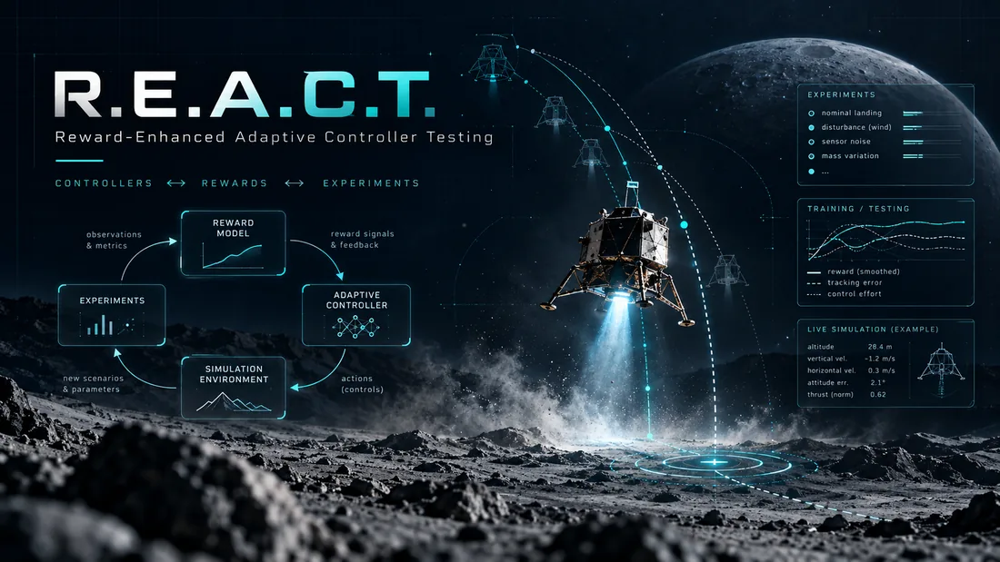
  </a>

  <a href="https://github.com/ManpreetS2/EquityTrace">
    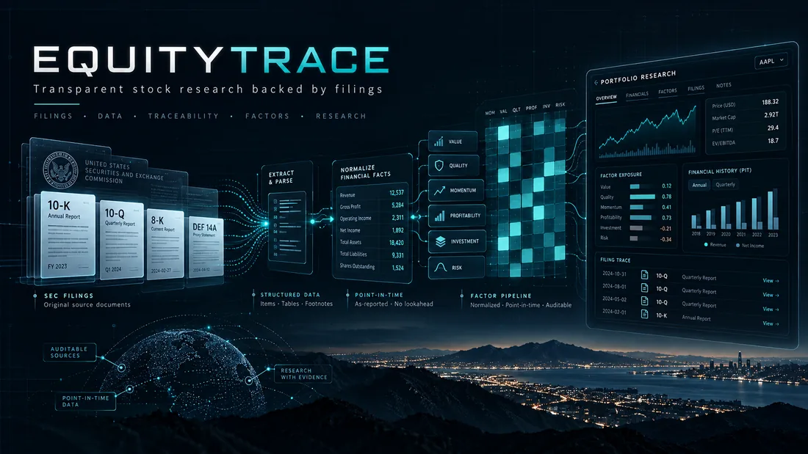
  </a>

  <a href="https://github.com/ManpreetS2/Minecraft-Ai-Civilization">
    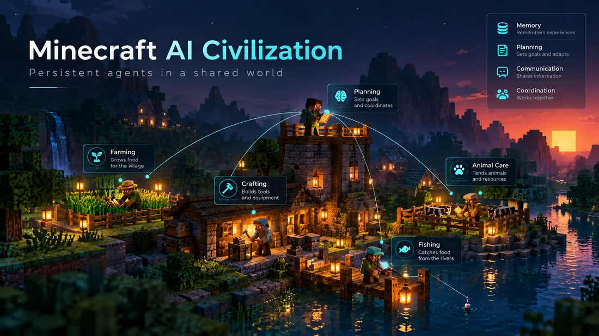
  </a>

  
    Also:
    <a href="https://github.com/ManpreetS2/StrikeCaller">StrikeCaller</a>
    ·
    <a href="https://github.com/ManpreetS2/PagePulse">PagePulse</a>
    ·
    <a href="https://github.com/ManpreetS2/JavaBankingSystem">Java Banking System</a>
    ·
    <a href="https://github.com/ManpreetS2/System-Down-Simulator">System Down Simulator</a>
  

<picture>
  <source media="(max-width: 500px) and (prefers-color-scheme: dark)" srcset="assets/editorial/mobile/dark/s05.svg"/>
  <source media="(max-width: 500px)" srcset="assets/editorial/mobile/light/s05.svg"/>
  <source media="(prefers-color-scheme: dark)" srcset="assets/editorial/dark/s05.svg"/>
  
</picture>

<picture>
  <source media="(max-width: 500px) and (prefers-color-scheme: dark)" srcset="assets/editorial/mobile/dark/toolkit.svg"/>
  <source media="(max-width: 500px)" srcset="assets/editorial/mobile/light/toolkit.svg"/>
  <source media="(prefers-color-scheme: dark)" srcset="assets/editorial/dark/toolkit.svg"/>
  
</picture>

<picture>
  <source media="(max-width: 500px) and (prefers-color-scheme: dark)" srcset="assets/editorial/mobile/dark/footer.svg"/>
  <source media="(max-width: 500px)" srcset="assets/editorial/mobile/light/footer.svg"/>
  <source media="(prefers-color-scheme: dark)" srcset="assets/editorial/dark/footer.svg"/>
  
</picture>

  

    <a href="https://www.linkedin.com/in/manpreet-singh-1018b3299/">LinkedIn</a>
    ·
    <a href="mailto:manpreetsm2@gmail.com">Get in touch</a>
    ·
    <a href="https://github.com/ManpreetS2?tab=repositories">Repositories</a>
  

